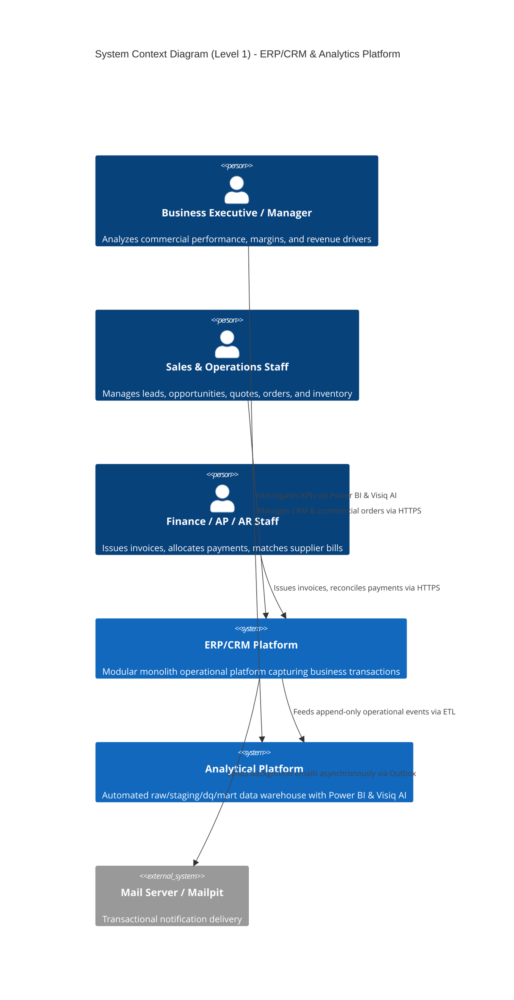
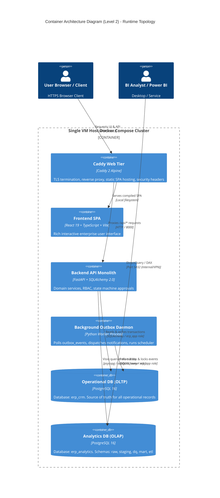
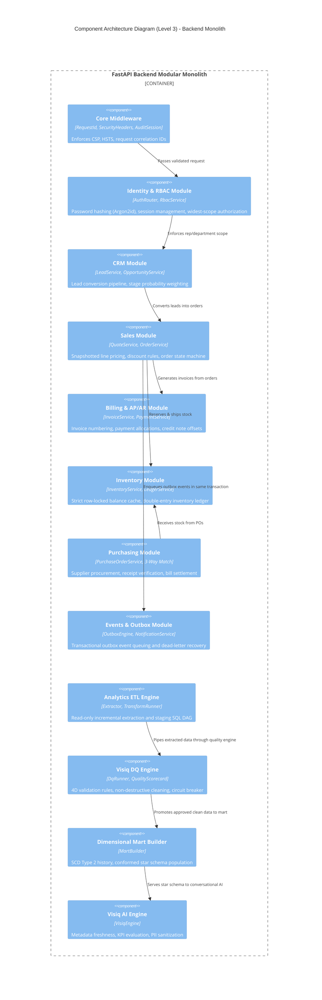
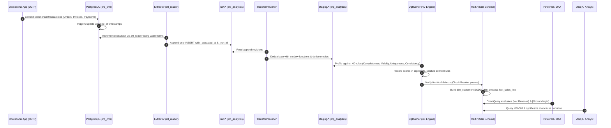

# System Architecture Blueprint

**Milestone V2.0: Integrated Business Intelligence Platform**  
**Classification:** Master Architecture Blueprint & Decision Record  
**Target Environments:** Single VM / Staging / Production  

---

## 1. Architectural Philosophy & Principles

The platform follows a deliberate, progressive engineering philosophy:
1. **Understand Business Generation First**: Software must capture how commercial systems generate operational data before attempting data engineering or analytics.
2. **Modular Monolith**: One cohesive FastAPI application with strictly isolated domain modules. No premature microservices or distributed network complexity.
3. **Dual-Database Boundary**: Operational OLTP (`erp_crm`) is physically and logically separated from the Analytical Data Warehouse (`erp_analytics`). No analytical tool, BI report, or AI agent ever queries the operational database directly.
4. **No Hard Deletes**: All master data is deactivated; all financial and commercial documents are voided/cancelled. Historical provenance is preserved for auditing and ETL extraction.
5. **Centavo Parity & Philippine Currency**: All monetary calculations use `NUMERIC(19, 2)` / Python `Decimal` with deterministic `ROUND_HALF_UP` math. Tax is configurable Philippine VAT (12%).

---

## 2. C4 Architecture Models

### Level 1: System Context Diagram

The System Context diagram illustrates the platform within its operating environment:

---

### Level 2: Container Architecture Diagram

The Container diagram illustrates the runtime deployment topology:

---

### Level 3: Component Architecture Diagram (Backend Monolith)

The Component diagram illustrates the internal modular structure of the FastAPI backend:

---

### Level 4: Code & Data Flow Pipelines

---

## 3. Database Isolation & Security Model

The platform enforces strict role separation across both PostgreSQL databases:

| Database | Role | Login Allowed | Permissions / Scope |
|---|---|---|---|
| `erp_crm` | `erp_owner` | Yes | Schema owner for `public`. Runs Alembic DDL migrations. Has `CREATEDB` for scratch restore test drills. |
| `erp_crm` | `erp_app` | Yes | API application role. DML only (`SELECT, INSERT, UPDATE, DELETE`). Strictly prohibited from executing DDL (`CREATE, ALTER, DROP`). |
| `erp_crm` | `etl_reader` | Yes | Read-only extraction role. Granted `SELECT` only on operational tables. Cannot modify operational data. |
| `erp_analytics` | `analytics_owner` | Yes | Owns schemas `raw, staging, dq, mart, etl`. Manages analytical tables, views, and data marts. |

---

## 4. Architecture Decision Records (ADR Index)

All architectural decisions are formally indexed and enforced:

| ADR | Title | Milestone | Core Decision & Trade-Off |
|---|---|---|---|
| **ADR-0001** | Modular Monolith Architecture | V0.1 | Single FastAPI application divided into strict domain modules (`identity`, `crm`, `sales`, `inventory`, `purchasing`, `events`). Trade-off: eliminates distributed network latency at the expense of strict intra-process import linting. |
| **ADR-0002** | BigInteger Identity Keys & Separate Business Numbers | V0.1 | Primary keys are internal `BIGINT GENERATED ALWAYS AS IDENTITY`. Human-readable identifiers (`INV-2026-000001`) are separate, formatted, indexed unique columns. |
| **ADR-0003** | Server-Side Cookie Sessions with CSRF | V0.1 | HttpOnly, SameSite=Lax server-side cookie sessions rather than stateless JWTs. Trade-off: enables instant session revocation upon role/permission changes at the cost of database session lookup. |
| **ADR-0004** | Centavo Parity & Deterministic Rounding | V0.1 | All money stored as `NUMERIC(19, 2)` / Python `Decimal`. Single rounding implementation in `core/money.py` using `ROUND_HALF_UP`. DB CHECK constraints enforce `subtotal + tax_total = grand_total`. |
| **ADR-0005** | No Hard Deletes Policy | V0.1 | Master data uses `is_active`; commercial documents transition to `cancelled` or `voided`. Soft status preservation guarantees historical auditability and watermark ETL tracking. |
| **ADR-0006** | Text Constraints Over Postgres Native ENUMs | V0.1 | Replaced `pg_enum` with `TEXT` + `CHECK (col IN (...))`. Enables seamless zero-downtime schema migrations when adding new workflow statuses without database locks. |
| **ADR-0007** | Generic Entity Status History Tracking | V0.2 | Reusable `status_history` table capturing every entity transition (`from_status`, `to_status`, `reason`, `changed_by`, `changed_at`). Provides unified lifecycle tracking for leads, orders, invoices, and POs. |
| **ADR-0008** | Single Company, PHP Currency, Configurable VAT | V0.1 | Scope locked to single-company domestic operations in Philippine Pesos with configurable 12% VAT. Avoids premature multi-tenancy and multi-currency complexity. |
| **ADR-0009** | Gapless Document Numbering via Locked Sequences | V0.3 | Document numbers are allocated via `SELECT ... FOR UPDATE` against `document_sequences` in the same transaction as document insert. Guarantees gapless numbering on rollbacks. |
| **ADR-0010** | Double-Entry Inventory Ledger & Cached Balances | V0.4 | Inventory ledger is the single source of truth; `inventory_balances` is a row-locked cache updated in the same transaction. Weighted average costing (WAC) recalculated per product per warehouse. |
| **ADR-0011** | Permission Hierarchy & Widest Scope Authorization | V0.6 | Declarative permission checks (`sales:order:create`). Scopes resolve dynamically: `all > department > rep`. Prevents IDOR vulnerabilities through strict 404 masking. |
| **ADR-0012** | State Machine Engine & Dynamic Approval Thresholds | V0.7 | Document state machine transitions are defined in code; financial approval thresholds (e.g., discounts >15%, PO spend >₱100,000) are stored in the database, allowing threshold adjustment without redeploy. |
| **ADR-0013** | Dual-Database Separation with Read-Only ETL Role | V1.1 | Physical separation of OLTP and OLAP into `erp_crm` and `erp_analytics`. ETL extracts via dedicated read-only role `etl_reader`. Eliminates operational interference from reporting queries. |
| **ADR-0014** | Permission-Gated AI Tools with PII Sanitization | V1.6 | AI models (Visiq and ERP Assistant) cannot execute raw SQL. All data access occurs through typed, permission-checked tools with automatic PII masking (RA 10173 compliance). |
| **ADR-0015** | Transactional Outbox Pattern for Background Automation | V1.8 | Domain events are committed atomically into `outbox_events` within business transactions. Independent worker daemon polls, processes, retries with exponential backoff, and dead-letters failures. |
| **ADR-0016** | Double-Entry General Ledger Immutability & Reversals | V2.1 | Chart of Accounts with strict double-entry balance enforcement (`SUM(debits) == SUM(credits)`). Once posted, journal entries are permanently immutable; corrections require explicit reversing counter-entries. |
| **ADR-0017** | Automated Subledger-to-GL Real-Time Posting & Financial Statements | V2.2 | Operational subledger events automatically generate posted double-entry journal vouchers in real time. Voiding creates formal counter-entry reversals. Financial statement generation (Balance Sheet, Income Statement) evaluates dynamic accounting period balances with exact centavo parity (`Assets = Liabilities + Equity + Net Income`). |

---

## 5. Known Limitations & Technical Debt

1. **Single Company / Single Currency**:
   - The platform models single domestic Philippine operations (PHP). Multi-currency conversion, FX gain/loss revaluations, and consolidated group reporting are planned for future major releases.
2. **Automated Subledger-to-GL Realized**:
   - Milestone V2.2 completes the real-time subledger-to-GL posting pipeline (AR Invoices, Payments, Credit Notes, AP Bills, AP Disbursements) and provides GAAP/PFRS-compliant Balance Sheet and Income Statement reporting.
3. **Polling Outbox Worker**:
   - Uses row-level lock polling (`SKIP LOCKED`) every 5 seconds. Highly reliable for current throughput, but would benefit from `LISTEN / NOTIFY` or Kafka if event throughput exceeds 1,000 events/second.
4. **CDC Extraction vs Batch Watermarks**:
   - Extraction uses `updated_at` watermarks with a configurable 10-minute overlap window. Suitable for batch schedules, but sub-second streaming would require Debezium / Postgres logical replication.

---

## 6. What I'd Do Next (Phase 3 Roadmap)

1. **Change Data Capture (CDC)**: Implement Debezium logical replication streaming directly from PostgreSQL WAL logs into the `raw` analytics schema for sub-second data freshness.
2. **BIR-Accredited Invoicing & E-Invoicing**: Add BIR 2307 withholding tax certificates and official electronic invoice signature payloads for Philippine tax compliance.
3. **Advanced ML Predictive Forecasting**: Train Holt-Winters exponential smoothing and Prophet models on `mart.fact_sales_line` to deliver automated demand forecasting and reorder point optimization directly into Visiq.
4. **Multi-Warehouse Automated Replenishment**: Implement automated inter-warehouse transfer orders based on localized low-stock alerts and safety stock triggers.
