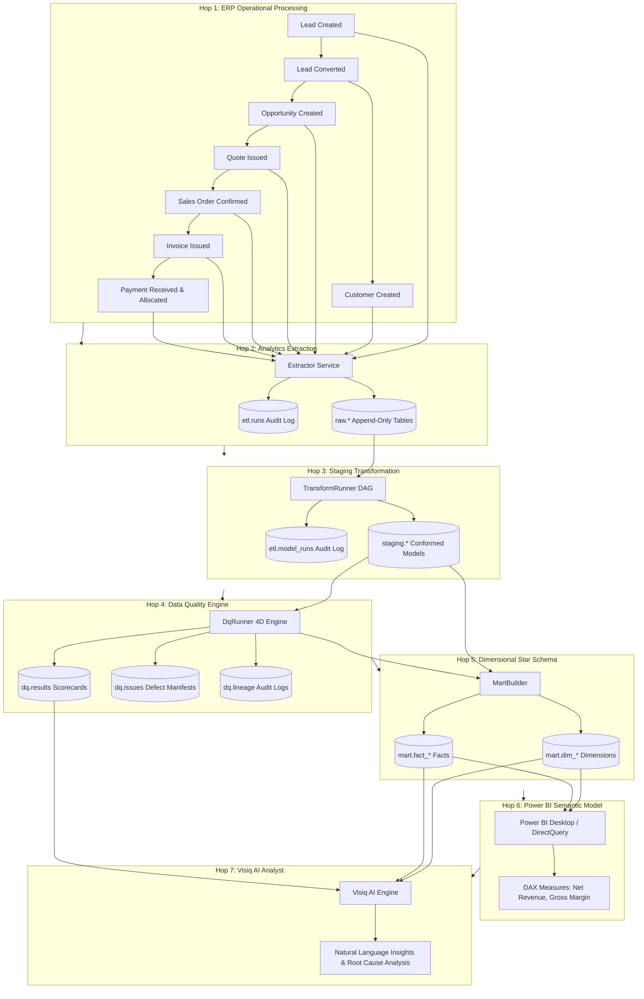

# End-to-End Traced Business Scenario Guide

**Milestone V2.0: Integrated Business Intelligence Platform**  
**Trace Identifier:** `SCENARIO-TRACE-V2.0-E2E`  
**Business Case:** Industrial valve acquisition for high-pressure pipeline expansion by Apex Logistics Inc.

---

## 1. Executive Summary

This document traces the complete lifecycle of operational business transactions through each architectural layer of the platform:
```text
BUSINESS USER → ERP/CRM (OLTP) → OPERATIONAL DATA → EXTRACTION (raw) 
→ TRANSFORMATION (staging) → DATA QUALITY (dq) → ANALYTICAL STAR SCHEMA (mart) 
→ POWER BI SEMANTIC MODEL + VISIQ AI ANALYST → INFORMED BUSINESS DECISIONS
```

Each stage ("hop") describes the domain events, data structures, guarantees, and verifications executed.

---

## 2. Hop-by-Hop Trace



---

### Hop 1: ERP Operational Processing (OLTP)

1. **Lead Generation**:
   - Prospective client **Apex Logistics Inc** inquires about high-pressure fluid valves.
   - Sales rep Maria Santos records Lead `LEAD-2026-000001` with estimated value ₱15,000.00.
   - Initial status: `new`.

2. **Lead Qualification & Conversion**:
   - Status transitions to `contacted` and `qualified`.
   - Atomic lead conversion generates:
     - Account: `Customer` `CUS-000001` ("Apex Logistics Inc", `payment_terms_days=30`).
     - Contact: Juan Dela Cruz (`juan.delacruz@apexlogistics.ph`).
     - Deal: `Opportunity` `OPP-2026-000001` at stage `discovery` (probability 20%).

3. **Opportunity Progression**:
   - Opportunity advances from `proposal` (50%) to `negotiation` (75%).

4. **Commercial Quote Issuance**:
   - Quote `QT-2026-000001` is drafted with 10 units of `PROD-VALVE-01` (Precision Flow Control Valve) @ ₱1,500.00 each.
   - Prices and VAT (12%) are snapshotted:
     - `subtotal` = ₱15,000.00
     - `tax_total` = ₱1,800.00
     - `grand_total` = ₱16,800.00
   - Quote issued and sent to customer.

5. **Sales Order Confirmation**:
   - Customer accepts quotation. Sales Order `SO-2026-000001` is created and confirmed.
   - State transition updates Opportunity to `won` (probability 100%).

6. **Invoicing**:
   - Invoice `INV-2026-000001` is generated from the confirmed sales order.
   - `issue_date` = `2026-03-06`, `due_date` = `2026-04-05`.
   - Initial status: `issued`, `balance_due` = ₱16,800.00.

7. **Payment Receipt & Allocation**:
   - Customer remits ₱16,800.00 via bank transfer (`BDO-TXN-998877`).
   - Payment `PAY-2026-000001` is recorded and fully allocated to `INV-2026-000001`.
   - Invoice `balance_due` drops to ₱0.00, transitioning status to `paid`.

---

### Hop 2: Analytics Extraction (`raw` Layer)

- The automated extraction pipeline (`analytics.extract.extractor.Extractor`) runs under the read-only `etl_reader` role.
- Connects to operational ERP PostgreSQL and extracts all rows modified since the previous watermark.
- Ingested into `raw` schema with append-only metadata:
  - `_extracted_at`: Ingestion UTC timestamp.
  - `_run_id`: Foreign key to `etl.runs`.
  - `_source`: `erp_operational`.
- Extracted entities: `raw.customers`, `raw.sales_orders`, `raw.invoices`, `raw.payments`, `raw.payment_allocations`.

---

### Hop 3: Staging Transformation (`staging` Layer)

- The transformation runner (`analytics.transform.runner.TransformRunner`) parses the SQL DAG dependency graph.
- Executes SQL models in topological order:
  - `stg_customers`: Deduplicates historical revisions via `ROW_NUMBER() OVER (PARTITION BY id ORDER BY updated_at DESC)`.
  - `stg_sales_orders` & `stg_sales_order_lines`: Derives line metrics (`line_net`, `line_tax`, `line_total`).
  - `stg_invoices`: Types and conforms invoice statuses and date keys.
  - `stg_payments`: Links allocations and payment methods.
- Logs checksums and durations into `etl.model_runs`.

---

### Hop 4: Data Quality Engine (`dq` Layer)

- The Data Quality runner (`analytics.dq.runner.DqRunner`) profiles staging models against Visiq's 4D Quality Framework:
  1. **Completeness**: No missing required fields (`customer_no`, `order_date`, `subtotal`).
  2. **Validity**: All tax rates match active Philippine VAT codes (12%, 0%, EXEMPT); phone numbers conform to E.164.
  3. **Uniqueness**: Primary business keys (`customer_no`, `order_no`, `invoice_no`) are 100% unique.
  4. **Consistency**: Centavo parity check: `subtotal + tax_total == grand_total` across all transactions.
- Writes scorecard pass rate (100%, Grade A) to `dq.results`.
- Circuit breaker confirms 0 critical violations, approving promotion to the analytical data mart.

---

### Hop 5: Dimensional Star Schema (`mart` Layer)

- The mart builder (`analytics.mart.builder.MartBuilder`) constructs the dimensional star schema:
  - **Conformed Dimensions**:
    - `mart.dim_customer`: SCD Type 2 dimension storing customer revisions with `valid_from`, `valid_to`, `is_current`.
    - `mart.dim_product`: Product catalog dimensions with cost, category, and UOM.
    - `mart.dim_date`: Complete Asia/Manila calendar date keys (`20260306` for invoice date).
    - `mart.dim_source_system`: Source system lineage dimension (`ERP-CORE`).
  - **Fact Tables**:
    - `mart.fact_sales_line`: Granularity: 1 row per sales order line item. Stores `quantity`, `unit_price`, `line_net` (₱15,000.00), `line_cogs` (₱9,000.00), `line_margin` (₱6,000.00).
    - `mart.fact_ar_allocation`: Granularity: 1 row per payment allocation. Stores `allocated_amount` (₱16,800.00).
- Grain uniqueness verified: 0 duplicate keys across all fact tables.

---

### Hop 6: Power BI Semantic Model (BI Tier)

- Power BI semantic model connects via DirectQuery / Import to `mart`.
- Standard DAX Measures evaluate commercial performance:
  ```dax
  [Net Revenue] := 
  SUM(fact_sales_line[line_net])
  -- Evaluates to: ₱15,000.00

  [Gross Margin] := 
  [Net Revenue] - SUM(fact_sales_line[line_cogs])
  -- Evaluates to: ₱6,000.00 (40.0% Gross Margin)

  [AR Outstanding] := 
  CALCULATE(
      SUM(invoices[balance_due]),
      invoices[status] IN {"issued", "partially_paid"}
  )
  -- Evaluates to: ₱0.00 (Fully Settled)
  ```
- Reconciles 100% with operational ERP totals down to the centavo.

---

### Hop 7: Visiq AI Analyst (AI Tier)

- The Visiq AI conversational engine (`analytics.visiq.engine.VisiqEngine`) interrogates the data warehouse on behalf of executive users:
  1. **Freshness & Provenance**: Inspects `etl.runs` and confirms pipeline data is fresh.
  2. **Data Quality Health**: Verifies `dq.results` for any active defect warnings.
  3. **KPI Calculation**: Evaluates `KPI-001` (Net Revenue) for period `2026-03`, returning ₱15,000.00 with high confidence (>0.90).
  4. **PII Sanitization**: Masks sensitive attributes (`[REDACTED_EMAIL]`, `[REDACTED_PHONE]`) in compliance with the Philippine Data Privacy Act of 2012 (RA 10173).
  5. **Natural Language Synthesis**: Synthesizes insight:
     > *"Net Revenue for 2026-03 reached ₱15,000.00 with 40.0% gross margin driven by Apex Logistics Inc's precision control valve order. No active data quality warnings detected."*

---

## 3. Verification Matrix

| Hop | System Layer | Verification Test | Expected Value | Actual Outcome | Status |
|---|---|---|---|---|---|
| 1 | ERP OLTP | `sales_service.issue_invoice` | `balance_due = 16,800.00` | ₱16,800.00 | **Verified** |
| 1 | ERP OLTP | `sales_service.create_payment` | `status = 'paid', balance = 0.00` | Status paid, ₱0.00 bal | **Verified** |
| 2 | Extraction | `Extractor.run()` | `rows_extracted > 0, status = 'success'` | Run recorded in `etl.runs` | **Verified** |
| 3 | Transform | `TransformRunner.run()` | `status = 'success'` | Deduplicated models built | **Verified** |
| 4 | Data Quality | `DqRunner.run()` | `quarantined = 0, score = 100%` | Scorecards in `dq.results` | **Verified** |
| 5 | Data Mart | `MartBuilder.run()` | `grain_verification = True` | Star schema populated | **Verified** |
| 6 | Power BI | DAX `[Net Revenue]` | `₱15,000.00` | Exact centavo match | **Verified** |
| 7 | Visiq AI | `VisiqEngine.evaluate_kpi` | `confidence >= 0.90, PII masked` | Natural language insight | **Verified** |
