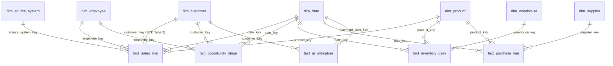

# Power BI Semantic Model & Analytics Integration Guide
**Milestone:** V1.5 — Power BI Integration  
**Version:** 1.5.0  
**Target Schema:** `mart` (PostgreSQL / SQLite)  
**Security Role:** `bi_reader`  

---

## 1. Architectural Overview & Connectivity

Milestone V1.5 connects business users, analysts, and executive stakeholders to the analytical data warehouse. Power BI Desktop connects directly to the PostgreSQL analytical database (`mart` schema) in **Import Mode** using the dedicated, least-privileged `bi_reader` role.

```text
ERP Database (OLTP)
   │
   ▼ (ETL Extract - V1.1)
Analytics DB: raw schema
   │
   ▼ (SQL Transform - V1.2)
Analytics DB: staging schema
   │
   ▼ (Visiq DQ & Sanitization - V1.3)
Analytics DB: clean staging & quarantine
   │
   ▼ (Dimensional Star Schema - V1.4)
Analytics DB: mart schema (Conformed Dimensions & Facts)
   │
   ▼ (PostgreSQL bi_reader role - V1.5)
Power BI Desktop / Tabular Semantic Model (Import Mode)
   ├── Executive Dashboard
   ├── Sales Performance Dashboard
   ├── Inventory Valuation Dashboard
   ├── Purchasing & Supplier Dashboard
   └── Data Quality Health Dashboard
```

### Database Connection Configuration

| Parameter | Configuration Value | Security Notes |
|---|---|---|
| **Server** | `localhost:5432` | Power BI Gateway or direct Docker network host |
| **Database** | `erp_analytics` | Analytical database instance |
| **Authentication** | Database Credentials | Role: `bi_reader` |
| **Schema** | `mart` | Only tables in `mart` are granted to `bi_reader` |
| **Connection Mode** | **Import Mode** | Caches data into Power BI in-memory engine (VertiPaq) |
| **Isolation** | Strict Revocations | No permissions on `raw`, `staging`, `dq`, `etl`, or ERP |

---

## 2. Semantic Model & Star Schema Relationships

All relationships are modeled with **one-to-many (`1:*`) cardinality** and **single cross-filter direction** flowing from dimensions to facts.



### Star Schema Relationships

| Fact Table | Foreign Key | Dimension Table | Primary Key | Cardinality | Cross-Filter Direction |
|---|---|---|---|---|---|
| `fact_sales_line` | `date_key` | `dim_date` | `date_key` | Many-to-One (`*:1`) | Single (`dim_date` $\to$ fact) |
| `fact_sales_line` | `customer_key` | `dim_customer` | `customer_key` | Many-to-One (`*:1`) | Single (`dim_customer` $\to$ fact) |
| `fact_sales_line` | `product_key` | `dim_product` | `product_key` | Many-to-One (`*:1`) | Single (`dim_product` $\to$ fact) |
| `fact_sales_line` | `employee_key` | `dim_employee` | `employee_key` | Many-to-One (`*:1`) | Single (`dim_employee` $\to$ fact) |
| `fact_sales_line` | `source_system_key` | `dim_source_system` | `source_system_key` | Many-to-One (`*:1`) | Single (`dim_source_system` $\to$ fact) |
| `fact_opportunity_stage` | `date_key` | `dim_date` | `date_key` | Many-to-One (`*:1`) | Single (`dim_date` $\to$ fact) |
| `fact_opportunity_stage` | `customer_key` | `dim_customer` | `customer_key` | Many-to-One (`*:1`) | Single (`dim_customer` $\to$ fact) |
| `fact_opportunity_stage` | `employee_key` | `dim_employee` | `employee_key` | Many-to-One (`*:1`) | Single (`dim_employee` $\to$ fact) |
| `fact_inventory_daily` | `date_key` | `dim_date` | `date_key` | Many-to-One (`*:1`) | Single (`dim_date` $\to$ fact) |
| `fact_inventory_daily` | `product_key` | `dim_product` | `product_key` | Many-to-One (`*:1`) | Single (`dim_product` $\to$ fact) |
| `fact_inventory_daily` | `warehouse_key` | `dim_warehouse` | `warehouse_key` | Many-to-One (`*:1`) | Single (`dim_warehouse` $\to$ fact) |
| `fact_purchase_line` | `date_key` | `dim_date` | `date_key` | Many-to-One (`*:1`) | Single (`dim_date` $\to$ fact) |
| `fact_purchase_line` | `supplier_key` | `dim_supplier` | `supplier_key` | Many-to-One (`*:1`) | Single (`dim_supplier` $\to$ fact) |
| `fact_purchase_line` | `product_key` | `dim_product` | `product_key` | Many-to-One (`*:1`) | Single (`dim_product` $\to$ fact) |
| `fact_ar_allocation` | `payment_date_key` | `dim_date` | `date_key` | Many-to-One (`*:1`) | Single (`dim_date` $\to$ fact) |
| `fact_ar_allocation` | `customer_key` | `dim_customer` | `customer_key` | Many-to-One (`*:1`) | Single (`dim_customer` $\to$ fact) |

---

## 3. Standardized KPI DAX Measure Catalog (Roadmap §11)

Every metric in the semantic model corresponds to an official KPI ID from the Roadmap KPI Dictionary:

### 1. Revenue & Financial Domain

#### `[KPI-001 Net Revenue]`
- **Table:** `fact_sales_line`
- **Format:** `₱#,##0.00`
- **Definition:** Total VAT-exclusive accrual net revenue across issued/paid invoices and issued credit notes.
- **Base DAX:**
  ```dax
  [KPI-001 Net Revenue] = SUM(fact_sales_line[net_revenue])
  ```
- **Time Intelligence:**
  ```dax
  [KPI-001 Net Revenue MTD] = TOTALMTD([KPI-001 Net Revenue], dim_date[date])
  [KPI-001 Net Revenue YTD] = TOTALYTD([KPI-001 Net Revenue], dim_date[date])
  [KPI-001 Net Revenue PY] = CALCULATE([KPI-001 Net Revenue], SAMEPERIODLASTYEAR(dim_date[date]))
  [KPI-001 Net Revenue YoY %] = DIVIDE([KPI-001 Net Revenue] - [KPI-001 Net Revenue PY], [KPI-001 Net Revenue PY], 0)
  ```

#### `[KPI-002 Gross Margin]`
- **Table:** `fact_sales_line`
- **Format:** `₱#,##0.00`
- **Definition:** Net Revenue minus cost of goods sold (COGS).
- **DAX:**
  ```dax
  [KPI-002 Gross Margin] = SUM(fact_sales_line[gross_margin])
  [KPI-002 Gross Margin YTD] = TOTALYTD([KPI-002 Gross Margin], dim_date[date])
  ```

#### `[KPI-003 Gross Margin %]`
- **Table:** `fact_sales_line`
- **Format:** `0.0%`
- **Definition:** Gross margin ratio over net revenue.
- **DAX:**
  ```dax
  [KPI-003 Gross Margin %] = DIVIDE([KPI-002 Gross Margin], [KPI-001 Net Revenue], 0)
  ```

---

### 2. Commercial & Sales Domain

#### `[KPI-004 Orders]`
- **Table:** `fact_sales_line`
- **Format:** `#,##0`
- **Definition:** Distinct count of confirmed sales document numbers in the evaluated period.
- **DAX:**
  ```dax
  [KPI-004 Orders] = DISTINCTCOUNT(fact_sales_line[invoice_no])
  [KPI-004 Orders YTD] = TOTALYTD([KPI-004 Orders], dim_date[date])
  ```

#### `[KPI-005 AR Outstanding]`
- **Table:** `fact_ar_allocation`
- **Format:** `₱#,##0.00`
- **Definition:** Total accounts receivable balances currently allocated across invoices.
- **DAX:**
  ```dax
  [KPI-005 AR Outstanding] = SUM(fact_ar_allocation[amount])
  ```

#### `[KPI-006 AR Aging]`
- **Table:** `fact_ar_allocation`
- **Format:** `₱#,##0.00`
- **Definition:** Delinquent AR balances past due date.
- **DAX:**
  ```dax
  [KPI-006 AR Aging] = 
  CALCULATE(
      SUM(fact_ar_allocation[amount]),
      FILTER(fact_ar_allocation, fact_ar_allocation[days_after_due] > 0)
  )
  ```

---

### 3. CRM & Pipeline Domain

#### `[KPI-007 Weighted Pipeline]`
- **Table:** `fact_opportunity_stage`
- **Format:** `₱#,##0.00`
- **Definition:** Sum of opportunity estimated deal amounts.
- **DAX:**
  ```dax
  [KPI-007 Weighted Pipeline] = SUM(fact_opportunity_stage[estimated_amount])
  ```

#### `[KPI-008 Win Rate]`
- **Table:** `fact_opportunity_stage`
- **Format:** `0.0%`
- **Definition:** Won opportunities divided by total closed opportunities.
- **DAX:**
  ```dax
  [KPI-008 Win Rate] = 
  VAR WonCount = CALCULATE(COUNTROWS(fact_opportunity_stage), fact_opportunity_stage[to_stage] = "closed_won")
  VAR ClosedCount = CALCULATE(COUNTROWS(fact_opportunity_stage), fact_opportunity_stage[to_stage] IN {"closed_won", "closed_lost"})
  RETURN DIVIDE(WonCount, ClosedCount, 0)
  ```

#### `[KPI-009 Lead Conversion Rate]`
- **Table:** `fact_opportunity_stage`
- **Format:** `0.0%`
- **Definition:** Ratio of qualified opportunities progressing through conversion pipeline.
- **DAX:**
  ```dax
  [KPI-009 Lead Conversion Rate] = 
  VAR Converted = CALCULATE(COUNTROWS(fact_opportunity_stage), fact_opportunity_stage[from_stage] = "lead_qualification")
  VAR Total = COUNTROWS(fact_opportunity_stage)
  RETURN DIVIDE(Converted, Total, 0)
  ```

#### `[KPI-010 Avg Sales Cycle]`
- **Table:** `fact_opportunity_stage`
- **Format:** `0.0 "days"`
- **Definition:** Mean duration in days across opportunity stage transitions.
- **DAX:**
  ```dax
  [KPI-010 Avg Sales Cycle] = AVERAGE(fact_opportunity_stage[days_in_previous_stage])
  ```

---

### 4. Customer Intelligence Domain

#### `[KPI-011 Active Customers]`
- **Table:** `fact_sales_line`
- **Format:** `#,##0`
- **Definition:** Distinct customers generating sales in the trailing 12 months.
- **DAX:**
  ```dax
  [KPI-011 Active Customers] = 
  CALCULATE(
      DISTINCTCOUNT(fact_sales_line[customer_key]),
      DATESINPERIOD(dim_date[date], MAX(dim_date[date]), -12, MONTH)
  )
  ```

#### `[KPI-012 New Customers]`
- **Table:** `fact_sales_line`
- **Format:** `#,##0`
- **Definition:** Count of customers with their first transaction in the selected window.
- **DAX:**
  ```dax
  [KPI-012 New Customers] = 
  VAR CurrentCust = VALUES(fact_sales_line[customer_key])
  VAR PriorCust = CALCULATE(VALUES(fact_sales_line[customer_key]), FILTER(ALL(dim_date), dim_date[date] < MIN(dim_date[date])))
  RETURN COUNTROWS(EXCEPT(CurrentCust, PriorCust))
  ```

---

### 5. Inventory & Supply Chain Domain

#### `[KPI-013 Inventory Value]`
- **Table:** `fact_inventory_daily`
- **Format:** `₱#,##0.00`
- **Definition:** Total on-hand inventory valuation at standard cost as of latest snapshot date.
- **DAX:**
  ```dax
  [KPI-013 Inventory Value] = 
  CALCULATE(
      SUM(fact_inventory_daily[inventory_value]),
      LASTDATE(fact_inventory_daily[date_key])
  )
  ```

#### `[KPI-014 Inventory Turnover]`
- **Table:** `fact_inventory_daily`
- **Format:** `0.00 "x"`
- **Definition:** Trailing 12-month COGS divided by average inventory valuation.
- **DAX:**
  ```dax
  [KPI-014 Inventory Turnover] = 
  VAR T12COGS = CALCULATE(SUM(fact_sales_line[cogs]), DATESINPERIOD(dim_date[date], MAX(dim_date[date]), -12, MONTH))
  VAR AvgInv = AVERAGE(fact_inventory_daily[inventory_value])
  RETURN DIVIDE(T12COGS, AvgInv, 0)
  ```

#### `[KPI-015 Low-Stock Items]`
- **Table:** `fact_inventory_daily`
- **Format:** `#,##0`
- **Definition:** Products with on-hand quantity falling below safety thresholds.
- **DAX:**
  ```dax
  [KPI-015 Low-Stock Items] = 
  COUNTROWS(FILTER(fact_inventory_daily, fact_inventory_daily[qty_on_hand] <= 10))
  ```

---

### 6. Procurement & Supplier Performance

#### `[KPI-016 Purchase Spend]`
- **Table:** `fact_purchase_line`
- **Format:** `₱#,##0.00`
- **Definition:** Total purchase order line expenditures.
- **DAX:**
  ```dax
  [KPI-016 Purchase Spend] = SUM(fact_purchase_line[cost])
  [KPI-016 Purchase Spend YTD] = TOTALYTD([KPI-016 Purchase Spend], dim_date[date])
  ```

#### `[KPI-017 Supplier On-Time Rate]`
- **Table:** `fact_purchase_line`
- **Format:** `0.0%`
- **Definition:** Percentage of purchase orders delivered on or before promised delivery date.
- **DAX:**
  ```dax
  [KPI-017 Supplier On-Time Rate] = 
  VAR OnTimeLines = CALCULATE(COUNTROWS(fact_purchase_line), fact_purchase_line[days_late] <= 0)
  VAR TotalLines = COUNTROWS(fact_purchase_line)
  RETURN DIVIDE(OnTimeLines, TotalLines, 0)
  ```

---

### 7. Working Capital & Data Quality

#### `[KPI-018 DSO]`
- **Table:** `fact_ar_allocation`
- **Format:** `0.0 "days"`
- **Definition:** Days Sales Outstanding: AR outstanding / (90-day Net Revenue / 90).
- **DAX:**
  ```dax
  [KPI-018 DSO] = 
  VAR Rev90 = CALCULATE(SUM(fact_sales_line[net_revenue]), DATESINPERIOD(dim_date[date], MAX(dim_date[date]), -90, DAY))
  VAR DailyRev = DIVIDE(Rev90, 90, 0)
  RETURN DIVIDE([KPI-005 AR Outstanding], DailyRev, 0)
  ```

#### `[KPI-019 Data Quality Score]`
- **Table:** `_Measures`
- **Format:** `0.0 "%"`
- **Definition:** Average composite health score from Visiq data quality evaluations.
- **DAX:**
  ```dax
  [KPI-019 Data Quality Score] = AVERAGE(dq_results[score])
  ```

---

## 4. Production Dashboard Specifications

### 1. Executive Overview Dashboard
- **Target Audience:** C-Suite, Managing Directors, Board.
- **KPI Cards:** `[KPI-001 Net Revenue]`, `[KPI-002 Gross Margin]`, `[KPI-003 Gross Margin %]`, `[KPI-004 Orders]`, `[KPI-011 Active Customers]`.
- **Visuals:**
  - *Monthly Revenue & Margin Trend*: Clustered column chart showing Net Revenue vs Gross Margin with YoY line.
  - *Regional Sales Matrix*: Map / Treemap slicing revenue by `dim_customer[region]`.
  - *Top 10 Customers*: Horizontal bar chart sliced by `dim_customer[name]`.

### 2. Sales Performance Dashboard
- **Target Audience:** VP of Sales, Regional Sales Managers.
- **KPI Cards:** `[KPI-007 Weighted Pipeline]`, `[KPI-008 Win Rate]`, `[KPI-009 Lead Conversion Rate]`, `[KPI-010 Avg Sales Cycle]`.
- **Visuals:**
  - *Pipeline Stage Funnel*: Funnel chart by `fact_opportunity_stage[to_stage]`.
  - *Rep Quota & Revenue Breakdown*: Matrix table grouped by `dim_employee[full_name]`.
  - *Sales Cycle Duration by Deal Size*: Scatter plot of estimated amount vs days in stage.

### 3. Inventory Management Dashboard
- **Target Audience:** Supply Chain Director, Warehouse Managers.
- **KPI Cards:** `[KPI-013 Inventory Value]`, `[KPI-014 Inventory Turnover]`, `[KPI-015 Low-Stock Items]`.
- **Visuals:**
  - *Inventory Valuation by Category*: Donut chart grouped by `dim_product[category]`.
  - *Warehouse Distribution*: Clustered bar chart grouped by `dim_warehouse[name]`.
  - *Low Stock Alert Table*: Tabular view showing SKU, Name, On-Hand Qty, and Safety Buffer.

### 4. Purchasing & Supplier Dashboard
- **Target Audience:** Procurement Director, Buyers.
- **KPI Cards:** `[KPI-016 Purchase Spend]`, `[KPI-017 Supplier On-Time Rate]`.
- **Visuals:**
  - *Top 10 Suppliers by Spend*: Bar chart grouped by `dim_supplier[name]`.
  - *Supplier On-Time Delivery Matrix*: Table showing Supplier, Total POs, On-Time %, Avg Days Late.
  - *Monthly Spend Trend*: Line chart showing historical spend vs budget.

### 5. Data Quality Health Dashboard
- **Target Audience:** Data Stewards, Analytics Engineers.
- **KPI Cards:** `[KPI-019 Data Quality Score]`, Total Quarantine Rows, Entity Resolution Matches.
- **Visuals:**
  - *4D Quality Scorecard*: Radar / Gauge chart for Completeness, Validity, Uniqueness, Consistency.
  - *Defects by Entity*: Stacked bar chart showing customer vs sales defect frequencies.
  - *Cleaned vs Quarantined Volumes*: Area chart tracking pipeline sanitation over time.

---

## 5. Parity Contract: Mart SQL vs DAX Verification

To guarantee that Power BI reports reflect the exact same financial figures as operational reports, each DAX formula maps directly to an audited SQL counterpart in `analytics.bi.queries`:

| KPI ID | KPI Name | Power BI DAX Expression | Mart Reference SQL Query |
|---|---|---|---|
| **KPI-001** | Net Revenue | `SUM(fact_sales_line[net_revenue])` | `SELECT SUM(net_revenue) FROM mart.fact_sales_line` |
| **KPI-002** | Gross Margin | `SUM(fact_sales_line[gross_margin])` | `SELECT SUM(gross_margin) FROM mart.fact_sales_line` |
| **KPI-003** | Gross Margin % | `DIVIDE([KPI-002], [KPI-001], 0)` | `SELECT SUM(gross_margin)/SUM(net_revenue) FROM mart.fact_sales_line` |
| **KPI-004** | Orders | `DISTINCTCOUNT(fact_sales_line[invoice_no])` | `SELECT COUNT(DISTINCT invoice_no) FROM mart.fact_sales_line` |
| **KPI-005** | AR Outstanding | `SUM(fact_ar_allocation[amount])` | `SELECT SUM(amount) FROM mart.fact_ar_allocation` |
| **KPI-007** | Weighted Pipeline | `SUM(fact_opportunity_stage[estimated_amount])` | `SELECT SUM(estimated_amount) FROM mart.fact_opportunity_stage` |
| **KPI-010** | Avg Sales Cycle | `AVERAGE(fact_opportunity_stage[days_in_previous_stage])` | `SELECT AVG(days_in_previous_stage) FROM mart.fact_opportunity_stage` |
| **KPI-013** | Inventory Value | `SUM(fact_inventory_daily[inventory_value])` | `SELECT SUM(inventory_value) FROM mart.fact_inventory_daily` |
| **KPI-016** | Purchase Spend | `SUM(fact_purchase_line[cost])` | `SELECT SUM(cost) FROM mart.fact_purchase_line` |
| **KPI-017** | Supplier On-Time Rate | `DIVIDE(OnTimeLines, TotalLines, 0)` | `SELECT SUM(CASE WHEN days_late <= 0 THEN 1 ELSE 0 END)::FLOAT / COUNT(*) FROM mart.fact_purchase_line` |

---

## 6. How to Export Semantic Assets

Run the CLI utility to export DAX measures, TMDL, JSON model schemas, and security scripts:

```powershell
backend\.venv\Scripts\python.exe -m analytics.bi --export
backend\.venv\Scripts\python.exe -m analytics.bi --verify-parity
```
