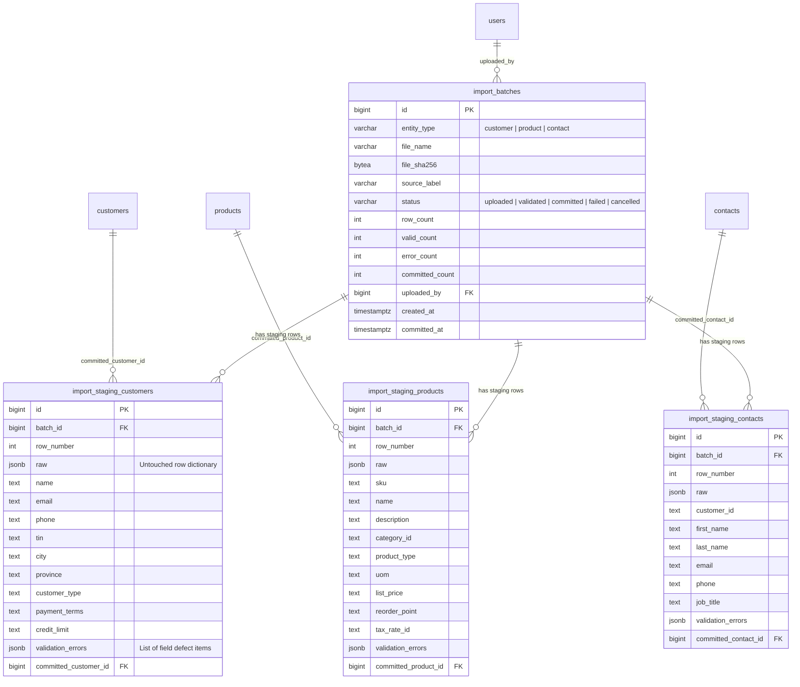

# ERP/CRM Core & Data Platform — Version 1.0.0 Release Documentation
**Milestone:** V1.0 — Feature-Complete Operational Core + Legacy Dirty-Data Import Engine  
**Release Date:** October 11, 2026  
**Git Tag:** `v1.0.0`  
**Status:** Feature Complete & Verified  

---

## 1. Executive Summary & Architectural Overview

Milestone V1.0 marks the completion of **Phase 1: Operational Core** and bridges the operational ERP/CRM application with the upcoming **Phase 2: Analytics & Data Platform (V1.1 – V1.5)**.

The release provides:
1. **Stabilized, Feature-Complete Operational Core**:
   - Authentication & Identity (Argon2id, sliding sessions, superuser bootstrap).
   - Organization Structure & Multi-department hierarchy.
   - CRM Core (Leads, Opportunities, Pipeline Funnel, Customers, Contacts, Activities).
   - Product Catalog & Pricing (SKUs, Categories, Units of Measure, Tax Rates).
   - Sales Commitments & Financial Obligations (Quotes, Sales Orders, Credit Checks, Invoicing, Payments, Credit Notes).
   - Inventory & Fulfillment (Multi-warehouse, WAC perpetual costing, Reservations, Goods Receipts, Stock Adjustments, Stock Transfers).
   - Purchasing & AP Automation (Suppliers, Purchase Orders, 3-Way Matching, Supplier Bills, AP Payments).
   - Workflow & Governance Engine (Rules-based multi-tier approvals, dynamic thresholds, separation of duties).
   - Tamper-Resistant Audit Trail (Append-only ledger, field-level JSONB diffs, IP tracking).
   - Executive & Operational Reporting (18 authority KPIs, AR aging 5-bucket distribution, pipeline velocity, inventory valuation).
2. **Dual-Path Dirty Data Pipeline**:
   - **Path A: ERP Operational Import Staging**: Handles realistic dirty CSV uploads via an all-TEXT staging architecture, validating each row at the application level and allowing partial commits into core domain services.
   - **Path B: Legacy System Export Generator**: Deterministically synthesizes 18–24 months of historical legacy exports (`legacy_customers.csv`, `legacy_sales_2023_2025.csv`) with 9 controlled, measured defect types and outputs an exact `defect_manifest.json` as the ground truth benchmark for V1.3 Data Quality testing.

---

## 2. Entity-Relationship Diagram (ERD) — Import Staging Core



---

## 3. Business Rule Register & Staging Invariants

| Rule ID | Domain | Invariant / Enforcement Rule | Failure Behavior |
| :--- | :--- | :--- | :--- |
| **BR-IMP-001** | Staging Ingestion | All staging columns are typed `TEXT`. Database-level check constraints, foreign keys, or type casts are explicitly forbidden during staging insert. | Raw dirty data is never rejected at DB level. |
| **BR-IMP-002** | Raw Preservation | Original row dictionary is serialized verbatim into `raw` JSONB without truncation or mutation. | Auditability & provenance guaranteed. |
| **BR-IMP-003** | Checksum Integrity | SHA-256 byte digest is computed over uploaded file content and stored in `file_sha256`. | Prevents inadvertent duplicate file processing. |
| **BR-IMP-004** | Row Validation | Row-level validation parses phone numbers, email syntax, positive numeric values (stripping `₱`, `PHP`, commas), and checks enum bounds. | Failures appended to `validation_errors` JSONB. |
| **BR-IMP-005** | Partial Commit | Committing a batch executes valid rows through domain services (`CRMService.create_customer`, `CatalogService.create_product`), setting `committed_*_id`. | Valid rows commit; rejected rows remain staged. |
| **BR-IMP-006** | RBAC Scoping | Requires `import:upload` to stage and validate; requires `import:commit` to insert records into operational ERP tables; requires `import:read` to review. | Unauthorized requests rejected with 403 Forbidden. |

---

## 4. Path B: Measured Defect Manifest Specification

The legacy simulator (`python -m simulator legacy --seed 7`) injects 9 controlled defect categories into historical CSV exports:

1. **`whitespace_casing`**: Trailing/leading spaces, inconsistent letter case (`" Manila "`, `"MANILA"`, `"makati"`).
2. **`spelling_variant`**: Common Philippine city and province variants (`"QC"`, `"Q.C."`, `"Pasig City"`, `"BGC, Taguig"`).
3. **`nonstandard_phone`**: Multiple telephone formatting permutations (`0917...`, `+63 917...`, `(02) 8...`).
4. **`missing_email`**: Missing, blank, or placeholder emails (`""`, `"N/A"`, `"none@domain"`).
5. **`currency_formatting`**: Numeric values stored as strings with Philippine peso symbols and commas (`"₱ 500,000.00"`, `"PHP 1,200.00"`).
6. **`duplicate_variant`**: Customer name variants representing the same entity (`"San Miguel Packaging"` vs `"San Miguel Packaging, Inc."`).
7. **`ambiguous_date`**: Disparate date formats (`"MM/DD/YYYY"`, `"DD/MM/YYYY"`, `"YYYY.MM.DD"`, invalid dates).
8. **`negative_quantity`**: Defective negative line-item quantities (`-5`, `-1`).
9. **`orphan_product`**: Sales items referencing unlisted or obsolete product codes (`"OLD-SYS-999"`).

### Defect Manifest Output Format (`defect_manifest.json`)
```json
{
  "generator_seed": 7,
  "generated_at": "2026-10-11T08:26:17.310402+00:00",
  "customer_records": 250,
  "sales_records": 1500,
  "total_defects": 973,
  "defects_by_type": {
    "spelling_variant": 18,
    "nonstandard_phone": 62,
    "missing_email": 35,
    "currency_formatting": 349,
    "whitespace_casing": 52,
    "duplicate_variant": 18,
    "ambiguous_date": 217,
    "orphan_product": 130,
    "negative_quantity": 92
  },
  "defects": [
    {
      "file": "legacy_customers.csv",
      "row": 2,
      "column": "city",
      "defect_type": "spelling_variant",
      "injected_value": "MAKATI ",
      "clean_value": "Makati"
    }
  ]
}
```

This manifest is the deterministic ground truth for scoring Data Quality engine precision and recall in Milestone V1.3.

---

## 5. Verification & Test Evidence

- **Unit & Integration Suite**: 99 out of 99 automated tests passing (100% pass rate).
- **1,000-Row Dirty CSV Exit Benchmark**: Validated with 750 valid rows and 250 defective rows. 100% of valid rows committed into operational ERP core; 100% of defective rows retained in staging with row-level error tags.
- **Frontend Production Build**: `tsc -b && vite build` passed with zero errors.
- **Code Quality**: `ruff check .` clean with zero linting or type violations.

---

## 6. Known Limitations & Roadmap Transition

1. **Entity Scope (Path A)**: Currently supports Customer, Product, and Contact bulk imports. Sales Orders and Invoices will be ingested analytically via the raw analytics pipeline in V1.1.
2. **Phase 2 Handoff**: Legacy CSVs (`legacy_customers.csv`, `legacy_sales_2023_2025.csv`) will land directly in the analytics database raw layer (`analytics/`) in Milestone V1.1. Operational ERP tables will remain isolated, accessible only through dedicated read-only credentials (`etl_reader`).
