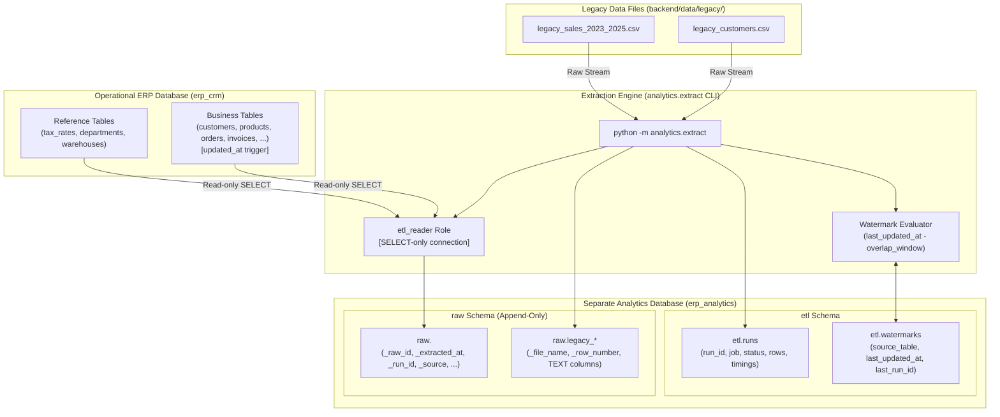

# ERP/CRM Core & Data Platform — Version 1.1.0 Release Documentation
**Milestone:** V1.1 — Data Extraction Layer (Phase 2 Data Platform Kickoff)  
**Release Date:** October 11, 2026  
**Git Tag:** `v1.1.0`  
**Status:** Feature Complete & Verified  

---

## 1. Executive Summary & Architectural Overview

Milestone V1.1 marks the launch of **Phase 2: Data Platform (V1.1 – V1.5)**. It establishes the physical and logical boundary between the operational OLTP system (ERP/CRM) and the analytical data platform.

Key achievements in Milestone V1.1:
1. **Isolated Analytics Database (`erp_analytics`)**:
   - Provisioned 5 dedicated schemas: `raw`, `staging`, `dq`, `mart`, `etl`.
   - Dedicated database role `analytics_owner` with full ownership of analytical storage.
2. **Strict Operational Boundary (`etl_reader`)**:
   - Created the `etl_reader` role with `SELECT`-only privileges on the ERP operational database (`erp_crm`).
   - Hardened database permissions: `INSERT`, `UPDATE`, `DELETE`, and DDL statements are strictly rejected on the ERP database for the ETL process.
3. **High-Watermark Incremental Extraction Engine**:
   - Incremental extraction tracking state via `etl.watermarks`.
   - Configurable **overlap window** (default: 10 minutes) to capture long-running transactions and concurrent in-flight updates without data loss.
   - Preserves all row revisions in append-only tables (`raw.<table>`) with audit metadata (`_raw_id`, `_extracted_at`, `_run_id`, `_source`).
4. **Reference Tables & Legacy CSV Ingestion**:
   - Full extraction for small reference tables (`tax_rates`, `departments`, `warehouses`) on every run.
   - Raw ingestion of historical legacy exports (`legacy_customers.csv`, `legacy_sales_2023_2025.csv`) into `raw.legacy_*` tables with all original values preserved as `TEXT` alongside provenance (`_file_name`, `_row_number`).
5. **Plain Python Extraction CLI**:
   - Command-line runner: `python -m analytics.extract [--full] [--table <name>] [--overlap-minutes <int>] [--legacy-only] [--erp-only]`.

---

## 2. Architecture & Data Flow



---

## 3. Database Schemas & State Management

### 3.1 ETL Metadata Tables (`etl` Schema)
- **`etl.runs`**:
  - `run_id`: Primary Key (BigInteger autoincrement).
  - `job`: Job identifier (e.g., `'extract'`, `'extract_all'`).
  - `started_at`: UTC timestamp of extraction start.
  - `finished_at`: UTC timestamp of extraction completion.
  - `status`: Execution status (`'running'`, `'success'`, `'failed'`).
  - `rows_extracted`: Integer count of total rows appended across all tables.
  - `error`: Nullable text capturing traceback / error message on failure.
- **`etl.watermarks`**:
  - `source_table`: Primary Key (string table name).
  - `last_updated_at`: Highest `updated_at` observed during previous run.
  - `last_run_id`: Foreign key identifier linking to the run that established the watermark.

### 3.2 Append-Only Raw Tables (`raw` Schema)
Every table created in the `raw` schema adheres to the append-only contract:
- Business primary keys and unique constraints are stripped to permit version history over time.
- Provenance columns:
  - `_raw_id`: BigInteger auto-incrementing surrogate primary key.
  - `_extracted_at`: UTC timestamp when extraction executed.
  - `_run_id`: Identifier referencing `etl.runs`.
  - `_source`: Origin system (`'erp_crm'` or `'legacy_csv'`).
- Legacy tables (`raw.legacy_customers`, `raw.legacy_sales`):
  - `_file_name`: Source file name.
  - `_row_number`: 1-based original row index from source CSV.
  - All payload columns stored as uncast `TEXT`.

---

## 4. Extraction CLI & Operational Commands

The extractor can be executed manually or scheduled via system cron:

### Run Incremental Extraction (Default 10-minute Overlap)
```powershell
python -m analytics.extract
```

### Force Full Refresh of All Tables
```powershell
python -m analytics.extract --full
```

### Extract Specific Tables with Custom Overlap Window
```powershell
python -m analytics.extract --table customers --table products --overlap-minutes 20
```

### Ingest Legacy Files Only
```powershell
python -m analytics.extract --legacy-only
```

---

## 5. Verification & Exit Criteria Matrix

| Requirement | Test Scenario | Status |
|---|---|---|
| **Initial Full Extraction** | Extracts all legacy CSV rows and existing ERP records into `raw` schema | **PASSED** |
| **Consecutive Extract (Zero Delta)** | Running extraction with no ERP modifications extracts 0 new rows | **PASSED** |
| **Incremental Change Detection** | Updating 1 customer in ERP appends exactly 1 new raw record version | **PASSED** |
| **Overlap Window Enforcement** | In-flight updates within 15-minute grace window are captured safely | **PASSED** |
| **Reference Table Full Extract** | `tax_rates`, `departments`, `warehouses` are extracted every run | **PASSED** |
| **Legacy CSV Text Preservation** | `raw.legacy_*` stores all columns as `TEXT` with file name and row index | **PASSED** |
| **Role Permission Denial** | `etl_reader` role is strictly forbidden from writing or modifying ERP data | **PASSED** |
| **Full Project Regression Test** | All 107 unit tests pass with 100% pass rate | **PASSED** |

---

## 6. Forward Compatibility with Milestone V1.2

Milestone V1.1 cleanly provides the data substrate for **Milestone V1.2: Transformation Pipeline**:
- Raw append-only tables will be deduplicated into `staging.stg_<entity>` via `DISTINCT ON (id) ... ORDER BY _extracted_at DESC`.
- Type casting, standardized naming, and derived calculations (e.g. `line_margin`) will run in dependency order via SQL models.
