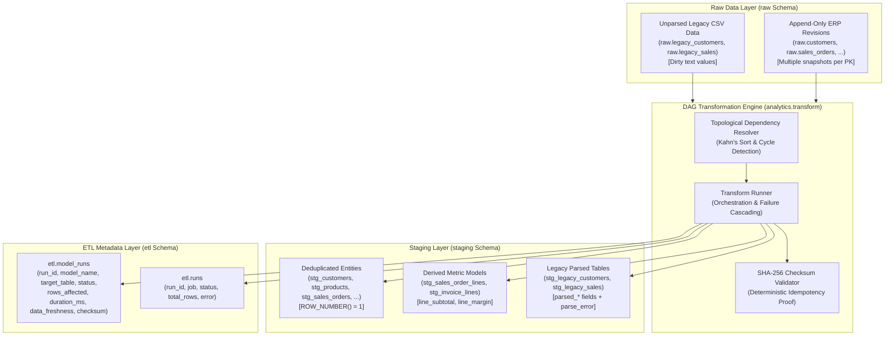

# ERP/CRM Core & Data Platform — Version 1.2.0 Release Documentation
**Milestone:** V1.2 — Transformation Pipeline (`raw → staging`)  
**Release Date:** October 11, 2026  
**Git Tag:** `v1.2.0`  
**Status:** Feature Complete & Verified  

---

## 1. Executive Summary & Architectural Overview

Milestone V1.2 implements the second tier of **Phase 2: Data Platform (V1.1 – V1.5)**. Building upon the append-only raw extraction layer established in V1.1, V1.2 delivers an idempotent, deterministic SQL transformation pipeline that transforms revision history and unparsed legacy CSV data into clean, typed, and deduplicated staging tables (`staging.stg_*`).

Key achievements in Milestone V1.2:
1. **Idempotent SQL Transformations (`raw → staging`)**:
   - Implemented cross-dialect (PostgreSQL and SQLite) ANSI SQL models using window function deduplication:  
     `ROW_NUMBER() OVER (PARTITION BY id ORDER BY _extracted_at DESC, _raw_id DESC) = 1`.
   - Every transformation run produces deterministic outputs, verified via 64-character SHA-256 table checksums.
2. **Derived Metric Calculations**:
   - Standardized calculations computed at staging time, including `line_subtotal` (`quantity * unit_price - discount`) and `line_margin` on `stg_sales_order_lines`.
   - Normalization of operational fields across purchasing, inventory, and sales entities.
3. **Legacy Parse Attempts with Error Preservation**:
   - `stg_legacy_customers`: Extracts clean integer credit terms days and numeric credit limits (stripping `₱`, `PHP`, commas, and whitespace) while retaining original raw dirty values and tracking `parse_error`.
   - `stg_legacy_sales`: Normalizes multiple date patterns (`YYYY-MM-DD`, `MM/DD/YYYY`, `YYYY.MM.DD`) into ISO-8601 strings. Identifies impossible calendar dates (such as `2024-02-30`) and records `parse_error = 'invalid_order_date'` with `parsed_order_date = NULL`, preserving all 1,500 legacy sales records without row loss.
4. **DAG Execution Engine & Failure Cascading**:
   - Developed `analytics.transform` engine with topological dependency resolution (Kahn's algorithm) and cyclic dependency detection.
   - Enforces **failure cascading**: if any model fails during execution, all downstream dependent models are halted and marked with `status="skipped"`.
   - Tracks data freshness (`MAX(_extracted_at)`) and execution metrics in `etl.model_runs`.
5. **CLI Transformation Tool**:
   - Command-line runner: `python -m analytics.transform [--model <name>] [--dry-run] [--job-name <name>]`.

---

## 2. Architecture & Data Flow



---

## 3. Staging Models Registry

The pipeline manages 20 core staging models residing in `analytics/models/staging/`:

| Staging Model | Target Table | Primary Source | Transformations & Derived Calculations |
|---|---|---|---|
| `stg_customers` | `staging.stg_customers` | `raw.customers` | Latest revision deduplication (`ROW_NUMBER() OVER (...) = 1`) |
| `stg_contacts` | `staging.stg_contacts` | `raw.contacts` | Deduplication by contact id |
| `stg_products` | `staging.stg_products` | `raw.products` | Deduplication by product id |
| `stg_sales_orders` | `staging.stg_sales_orders` | `raw.sales_orders` | Deduplication, status and currency snapshot mapping |
| `stg_sales_order_lines` | `staging.stg_sales_order_lines` | `raw.sales_order_items` | `line_subtotal = (qty * price) - discount`, `line_margin` |
| `stg_invoices` | `staging.stg_invoices` | `raw.invoices` | Deduplication, balance due and grand total mapping |
| `stg_invoice_lines` | `staging.stg_invoice_lines` | `raw.invoice_items` | `line_subtotal = (qty * price) - discount`, tax mapping |
| `stg_payments` | `staging.stg_payments` | `raw.payments` | Deduplication by payment id |
| `stg_quotes` | `staging.stg_quotes` | `raw.quotes` | Deduplication, expiration and grand total mapping |
| `stg_quote_lines` | `staging.stg_quote_lines` | `raw.quote_items` | Derived `line_subtotal` calculation |
| `stg_suppliers` | `staging.stg_suppliers` | `raw.suppliers` | Deduplication by supplier id |
| `stg_purchase_orders` | `staging.stg_purchase_orders` | `raw.purchase_orders` | Deduplication, delivery date and grand total mapping |
| `stg_purchase_order_lines` | `staging.stg_purchase_order_lines` | `raw.purchase_order_items` | Derived `line_subtotal = qty * unit_cost` |
| `stg_goods_receipts` | `staging.stg_goods_receipts` | `raw.goods_receipts` | Deduplication by receipt id |
| `stg_goods_receipt_lines` | `staging.stg_goods_receipt_lines` | `raw.goods_receipt_items` | Derived `line_total = qty * unit_cost` |
| `stg_departments` | `staging.stg_departments` | `raw.departments` | Full reference snapshot deduplication |
| `stg_tax_rates` | `staging.stg_tax_rates` | `raw.tax_rates` | Full reference snapshot deduplication |
| `stg_warehouses` | `staging.stg_warehouses` | `raw.warehouses` | Full reference snapshot deduplication |
| `stg_legacy_customers` | `staging.stg_legacy_customers` | `raw.legacy_customers` | Currency and terms parsing, `parsed_credit_limit`, `parse_error` |
| `stg_legacy_sales` | `staging.stg_legacy_sales` | `raw.legacy_sales` | Date normalization, invalid date detection (`2024-02-30`), `parse_error` |

---

## 4. State Management & Audit Logging (`etl.model_runs`)

Every transformation execution records granular execution telemetry into `etl.model_runs`:
- `id`: BigInteger surrogate primary key.
- `run_id`: References parent extraction or transformation run in `etl.runs`.
- `model_name`: Staging model name (e.g., `'stg_customers'`).
- `target_table`: Target table name in staging layer.
- `status`: Execution status (`'success'`, `'failed'`, `'skipped'`).
- `rows_affected`: Total rows created in staging table.
- `started_at` & `finished_at`: High-precision UTC timestamps.
- `duration_ms`: Execution time in milliseconds.
- `data_freshness`: `MAX(_extracted_at)` timestamp from source raw data.
- `checksum`: 64-character SHA-256 checksum over table contents.
- `error`: Error message or failure cascade reason if skipped/failed.

---

## 5. CLI Usage & Operational Commands

### Execute Full Transformation Pipeline
```powershell
python -m analytics.transform
```

### Dry Run Execution Plan (Prints Topological Order)
```powershell
python -m analytics.transform --dry-run
```

### Execute Specific Models (Includes Upstream Prerequisites Automatically)
```powershell
python -m analytics.transform --model stg_customers --model stg_sales_order_lines
```

---

## 6. Verification & Test Matrix

| Requirement | Test Scenario | Status |
|---|---|---|
| **Pipeline Idempotency** | Running transform twice yields exact same row counts and SHA-256 checksums | **PASSED** |
| **Window Deduplication** | Append-only raw updates resolve to single latest record in staging | **PASSED** |
| **Derived Metrics** | Calculates `line_subtotal` and `line_margin` on `stg_sales_order_lines` | **PASSED** |
| **Legacy Parse Attempts** | `stg_legacy_customers` strips currency symbols, keeps dirty strings intact | **PASSED** |
| **Calendar Date Validation** | `stg_legacy_sales` marks `2024-02-30` as NULL and records `invalid_order_date` | **PASSED** |
| **Zero Legacy Row Drops** | All 250 legacy customers and 1500 sales rows are retained in staging | **PASSED** |
| **Failure Cascading** | Upstream failure immediately marks downstream dependents as `skipped` | **PASSED** |
| **Data Freshness Tracking** | `etl.model_runs` accurately records `MAX(_extracted_at)` | **PASSED** |
| **DAG Cycle Detection** | Cyclic model dependencies raise `CyclicDependencyError` | **PASSED** |
| **Full Regression Suite** | All 114 unit tests pass with 100% pass rate | **PASSED** |

---

## 7. Forward Compatibility with Milestone V1.3

Milestone V1.2 provides the deduplicated, typed foundation for **Milestone V1.3: Data Quality Framework (`staging → dq`)**:
- The `parse_error` fields established in `stg_legacy_*` feed directly into Great Expectations / rule-based quality validation suites.
- Staging tables serve as the clean base for dimension and fact tables in Milestone V1.4 (`dq → mart`).
