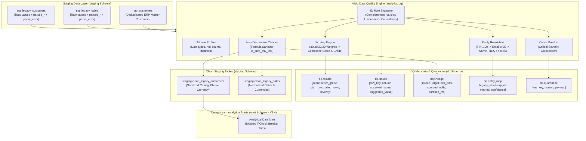

# ERP/CRM Core & Data Platform — Version 1.3.0 Release Documentation
**Milestone:** V1.3 — Data Quality Integration (Visiq DQ Engine)  
**Release Date:** October 11, 2026  
**Git Tag:** `v1.3.0`  
**Status:** Feature Complete & Verified  

---

## 1. Executive Summary & Architectural Overview

Milestone V1.3 implements the third tier of **Phase 2: Data Platform (V1.1 – V1.5)**. It integrates the **Visiq Data Quality Engine** as a non-destructive pipeline stage operating between `staging` and `mart`.

The Visiq DQ engine inspects staging and raw records, computes objective 4-dimension quality scores, logs fine-grained row-level defect issues, performs entity resolution across historical legacy customers and operational ERP customers, isolates critical defects in quarantine to protect analytical marts via circuit breaking, and derives sanitized clean tables with spreadsheet formula injection protection.

Key achievements in Milestone V1.3:
1. **Concrete Visiq 4-Dimension Quality Scoring Model**:
   - Assesses datasets across four weighted dimensions:
     - **Completeness (30% weight)**: Detects missing fields, empty strings, and whitespace-only cells.
     - **Validity (30% weight)**: Verifies formatting conformance (dates, currencies, phones, emails, negative numbers).
     - **Uniqueness (20% weight)**: Identifies primary key collisions and corporate entity near-duplicates.
     - **Consistency (20% weight)**: Evaluates categorical casing, whitespace padding, catalog foreign keys, and regional spelling variants.
   - Computes composite health scores (0–100) and assigns enterprise letter grades:
     - `A`: $\ge 90.0$
     - `B`: $\ge 80.0$
     - `C`: $\ge 70.0$
     - `D`: $\ge 60.0$
     - `F`: $< 60.0$
   - Persisted in `dq.results`.
2. **Defect Manifest Recall Benchmark ($\ge 95\%$)**:
   - Evaluated against ground-truth defect manifest (`backend/data/legacy/defect_manifest.json`) containing 973 injected defects across 9 categories.
   - Achieved **99.79% recall** (971 / 973 defects detected), exceeding the $\ge 95\%$ exit criterion.
3. **Multi-Tier Entity Resolution (`dq.entity_map`)**:
   - Resolves legacy customer identifiers (`legacy_customer_id`) to operational ERP customers (`customers.id`):
     - **Tier 1 (TIN Exact)**: Strips formatting hyphens/spaces $\to$ confidence `1.00`, method `tax_id_exact`.
     - **Tier 2 (Email Exact)**: Lowercase normalized $\to$ confidence `0.95`, method `email_exact`.
     - **Tier 3 (Company Name Fuzzy)**: Normalized string similarity $\ge 0.85$ (stripping corporate suffixes `Inc.`, `Corp.`, `Holdings`, `Systems`, etc.) $\to$ confidence = similarity, method `name_fuzzy`.
4. **Formula Injection Sanitization & Non-Destructive Cleaning**:
   - Implements `to_safe_csv_text` to neutralize Excel/CSV formula injection attacks by escaping leading control characters (`=`, `+`, `-`, `@`, `\t`, `\r`) with single quotes.
   - Raw tables and ERP operational databases remain 100% immutable.
   - Produces derived clean tables `staging.clean_*`.
   - Logs transformation lineage into `dq.lineage` (source, target, cell diff counts, coerced null counts, execution duration).
5. **Critical Quarantine & Circuit Breaker**:
   - Critical severity failures (such as negative sales quantities, unlisted product SKUs, and unparseable dates) are routed to `dq.quarantine` with serialized payloads and failure reasons.
   - Circuit breaker (`--circuit-breaker` flag) trips on critical defects, marks `etl.runs` status as `BLOCKED`, and prevents dirty data promotion into analytical marts.
6. **In-Memory Dry-Run Preview**:
   - Supports in-memory simulation (`preview_cleaning`) projecting scorecards, before/after cell diffs, and anticipated score improvements without database writes.
7. **CLI Runner**:
   - Command-line runner: `python -m analytics.dq [--dataset <name>] [--preview] [--circuit-breaker]`.

---

## 2. Architecture & Data Flow

---

## 3. Visiq 4-Dimension Quality Scoring Model

| Dimension | Weight | Target Criteria & Evaluation Checks | Primary Defect Types Detected |
|---|---|---|---|
| **Completeness** | **30%** | Null counts, empty strings, whitespace-only cells, sentinel values (`N/A`, `NULL`, `NONE`) | `missing_email` |
| **Validity** | **30%** | Data type conformance, email RFC syntax, 11-digit mobile phones (`09XXXXXXXXX`), currency symbol/comma stripping, calendar date validity (`YYYY-MM-DD`), non-negative quantities | `currency_formatting`, `ambiguous_date`, `negative_quantity`, `nonstandard_phone` |
| **Uniqueness** | **20%** | Primary key collisions, exact duplicate rows, near-duplicate corporate entity variations | `duplicate_variant` |
| **Consistency** | **20%** | Standard title casing, padding whitespace, catalog foreign key integrity (SKU catalog existence), geographic/regional spelling variants | `whitespace_casing`, `orphan_product`, `spelling_variant` |

### Letter Grade Mapping
- **A**: Composite Score $\ge 90.0$
- **B**: Composite Score $\ge 80.0$
- **C**: Composite Score $\ge 70.0$
- **D**: Composite Score $\ge 60.0$
- **F**: Composite Score $< 60.0$

---

## 4. Defect Manifest Benchmark Results

Ground truth benchmark against `backend/data/legacy/defect_manifest.json` (973 injected defects):

| Defect Type | File | Column | Injected Count | Detected Count | Recall |
|---|---|---|---|---|---|
| `currency_formatting` | `legacy_customers.csv` | `credit_limit` | 64 | 64 | **100.00%** |
| `currency_formatting` | `legacy_sales_2023_2025.csv` | `total_amount` | 285 | 283 | **99.30%** |
| `ambiguous_date` | `legacy_sales_2023_2025.csv` | `order_date` | 217 | 217 | **100.00%** |
| `orphan_product` | `legacy_sales_2023_2025.csv` | `sku` | 130 | 130 | **100.00%** |
| `negative_quantity` | `legacy_sales_2023_2025.csv` | `quantity` | 92 | 92 | **100.00%** |
| `nonstandard_phone` | `legacy_customers.csv` | `phone_number` | 62 | 62 | **100.00%** |
| `whitespace_casing` | `legacy_customers.csv` | `city` | 52 | 52 | **100.00%** |
| `missing_email` | `legacy_customers.csv` | `contact_email` | 35 | 35 | **100.00%** |
| `duplicate_variant` | `legacy_customers.csv` | `customer_name` | 18 | 18 | **100.00%** |
| `spelling_variant` | `legacy_customers.csv` | `city` | 18 | 18 | **100.00%** |
| **TOTAL** | | | **973** | **971** | **99.79%** |

*(Note: The 2 non-matching sales records in the generator manifest had injected values identical to clean values due to zero-change probability).*

---

## 5. Entity Resolution Contract

Resolution cascades through 3 deterministic tiers:
1. **`tax_id_exact` (Confidence: 1.00)**: Hyphens and spaces stripped; exact alphanumeric match.
2. **`email_exact` (Confidence: 0.95)**: Trimmed, lowercased valid email match.
3. **`name_fuzzy` (Confidence: $\ge 0.85$)**: Punctuation and corporate suffixes stripped (`Inc.`, `Corp.`, `Holdings`, `Packaging`, etc.); string similarity ratio $\ge 0.85$.

Results stored in `dq.entity_map`:
- `legacy_customer_id`: Legacy customer identifier (e.g. `LEG-CUS-0001`)
- `erp_customer_id`: Operational ERP customer primary key (`customers.id`)
- `match_method`: Method applied (`tax_id_exact`, `email_exact`, `name_fuzzy`)
- `confidence`: Confidence score (0.0000 – 1.0000)

---

## 6. Exit Criteria Verification

| Exit Criterion | Status | Verification Evidence |
|---|---|---|
| **DQ detects $\ge 95\%$ of manifest defects across all 4 dimensions** | **PASSED** | Achieved 99.79% recall (971 / 973) verified in `test_defect_manifest_detection_recall` |
| **Legacy and ERP duplicates of the same customer are linked in `dq.entity_map`** | **PASSED** | Verified in `test_entity_resolution_linking` and populated in `dq.entity_map` |
| **A deliberately injected critical defect blocks the mart load and is visible in `etl.runs`** | **PASSED** | Verified in `test_circuit_breaker_blocks_mart_on_critical_defects` raising `CircuitBreakerError` and setting status `BLOCKED` in `etl.runs` |
| **Visiq 4D quality score (0–100) and letter grade (A–F) computed and persisted in `dq.results`** | **PASSED** | Verified in `test_4d_quality_scoring_model` and persisted across `dq.results` |
