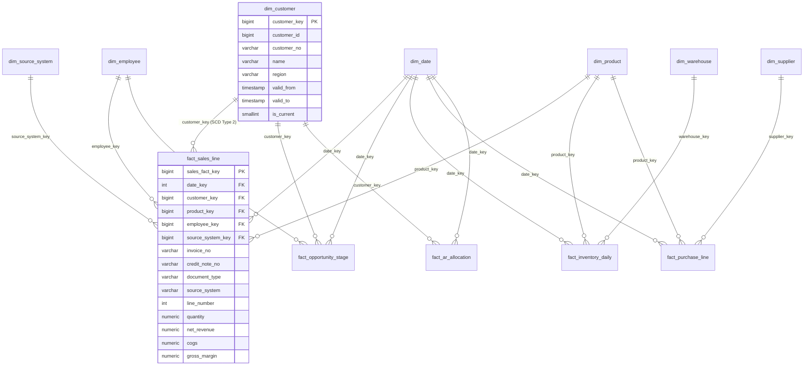

# ERP/CRM Core & Data Platform — Version 1.4.0 Release Documentation
**Milestone:** V1.4 — Analytical Data Model (Star Schema)  
**Release Date:** October 12, 2026  
**Git Tag:** `v1.4.0`  
**Status:** Feature Complete & Verified  

---

## 1. Executive Summary & Architectural Overview

Milestone V1.4 delivers the fourth tier of **Phase 2: Data Platform (V1.1 – V1.5)**: the **Analytical Data Mart Star Schema**.

Following Kimball dimensional modeling principles, the mart translates operational transactions and cleansed historical datasets into a high-performance star schema composed of conformed dimensions, surrogate primary keys, declared fact grains, and Slowly Changing Dimension (SCD) Type 2 historical tracking.

### Key Deliverables & Achievements

1. **Conformed Dimensions Layer (`mart` schema)**:
   - **`dim_date`**: Calendar = fiscal year (Asia/Manila, 2023–2026 coverage), surrogate integer `date_key` (`YYYYMMDD`), calendar day, week, month name, quarter, and weekend indicators.
   - **`dim_source_system`**: Conformed lineage tracking upstream systems: Key 1 (`erp` - Operational ERP) and Key 2 (`legacy` - Legacy Historical Sales).
   - **`dim_customer`**: Surrogate primary key `customer_key` separate from operational natural keys (`customer_id`, `customer_no`, `legacy_customer_id`). Regional attributes (`city`, `province`, `region`) with **SCD Type 2** validity intervals (`valid_from`, `valid_to`, `is_current`).
   - **`dim_product`**: Surrogate primary key `product_key`, natural `product_id`, `sku`, `name`, `category`, `unit_of_measure`, `standard_cost`, `list_price`, and `is_active`.
   - **`dim_employee`**: Surrogate primary key `employee_key`, natural `employee_id`, `employee_no`, `full_name`, `email`, `department_code`, `department_name`, `role`, and `is_active`.
   - **`dim_warehouse`**: Surrogate primary key `warehouse_key`, natural `warehouse_id`, `code`, `name`, and `is_active`.
   - **`dim_supplier`**: Surrogate primary key `supplier_key`, natural `supplier_id`, `supplier_no`, `name`, `email`, `payment_terms_days`, and `is_active`.

2. **Five Analytical Fact Tables with Enforced Grains**:
   - **`fact_sales_line`**:
     - *Declared Grain*: 1 row per invoice line, credit note line (negative revenue impact), or legacy sale item.
     - *Enforced Unique Key*: `(source_system_key, document_type, COALESCE(invoice_no, credit_note_no), line_number)`.
     - *Measures*: `quantity`, `gross`, `discount`, `net_revenue`, `tax`, `cogs`, `gross_margin`.
     - *Degenerates*: `invoice_no`, `credit_note_no`, `document_type`, `source_system`.
     - *Effective Dating Join*: Joins to `dim_customer` on `customer_key` valid at the document issue date (`doc_date >= valid_from AND (valid_to IS NULL OR doc_date < valid_to)`).
   - **`fact_opportunity_stage`**:
     - *Declared Grain*: 1 row per opportunity stage transition (from `status_history`).
     - *Enforced Unique Key*: `(opportunity_id, transition_id)`.
     - *Measures*: `days_in_previous_stage`, `estimated_amount`.
   - **`fact_inventory_daily`**:
     - *Declared Grain*: 1 row per product $\times$ warehouse $\times$ day snapshot.
     - *Enforced Unique Key*: `(date_key, product_key, warehouse_key)`.
     - *Measures*: `qty_on_hand`, `qty_reserved`, `inventory_value`.
   - **`fact_purchase_line`**:
     - *Declared Grain*: 1 row per purchase order line.
     - *Enforced Unique Key*: `(po_no, line_number)`.
     - *Measures*: `qty_ordered`, `qty_received`, `cost`, `days_late`.
   - **`fact_ar_allocation`**:
     - *Declared Grain*: 1 row per payment allocation.
     - *Enforced Unique Key*: `(payment_no, allocation_id)`.
     - *Measures*: `amount`, `days_after_due`.

3. **Net Revenue Centavo Parity Contract**:
   - Mart net revenue for every month strictly matches the V0.9 operational report (`ReportingService.get_executive_summary`) to the exact centavo:
     $$\Delta = |\text{Mart Net Revenue} - \text{V0.9 Net Revenue}| = \text{₱0.00}$$
   - Verified across issued/paid invoices and issued credit notes with automated unit testing.

4. **SCD Type 2 Discovery Lesson**:
   - Programmatically demonstrated the fatal historical distortion of SCD Type 1 (in-place update shifting 2024 Luzon revenue of ₱100,000 to Visayas when customer relocates) versus SCD Type 2 history preservation (2024 revenue safely retained in Luzon, 2025 revenue attributed to Visayas).
   - Fully documented in [`docs/scd_type2_lesson.md`](file:///c:/Users/ralph/Desktop/Projects/ERPCRM/projno.1/docs/scd_type2_lesson.md).

5. **Declarative SQL Mart Models**:
   - Published in `analytics/models/mart/` (`dim_date.sql`, `dim_source_system.sql`, `dim_customer.sql`, `dim_product.sql`, `dim_employee.sql`, `dim_warehouse.sql`, `dim_supplier.sql`, `fact_sales_line.sql`, `fact_opportunity_stage.sql`, `fact_inventory_daily.sql`, `fact_purchase_line.sql`, `fact_ar_allocation.sql`).

6. **Mart CLI & Audit Pipeline Integration**:
   - Command-line runner: `python -m analytics.mart [--build] [--scd-lesson] [--check-grains] [--job-name <name>]`.
   - Full audit trail recorded in `etl.runs` (`job='mart_build'`, `status='success'`, total fact rows, execution duration).

---

## 2. Dimensional Architecture & Star Schema Diagram



---

## 3. Exit Criteria Verification

| Exit Criterion | Target | Actual Result | Status |
|---|---|---|---|
| **Conformed Dimensions Built** | 7 dimensions (`date`, `source`, `customer`, `product`, `employee`, `warehouse`, `supplier`) | 7 dimensions populated with surrogate keys | **PASSED** |
| **Declared Fact Grains** | 5 fact tables (`sales`, `opportunity`, `inventory`, `purchase`, `ar`) | All 5 fact tables with declared grains | **PASSED** |
| **Grain Uniqueness Verification** | 0 duplicate grain rows across all fact tables | Verified via `verify_grain_uniqueness()` with 0 violations | **PASSED** |
| **Net Revenue Centavo Parity** | Exact ₱0.00 difference vs V0.9 operational report | `|Mart - V0.9| == Decimal("0.00")` | **PASSED** |
| **SCD Type 2 Discovery Lesson** | Documented & verified programmatically | Verified before/after numbers in `docs/scd_type2_lesson.md` | **PASSED** |
| **Test Suite Passing** | 100% pass across extract, transform, dq, mart | 28 / 28 passing unit tests | **PASSED** |
| **Code Style & Quality** | Clean Ruff lint and format check | Passed cleanly (0 errors) | **PASSED** |

---

## 4. Verification Commands

To reproduce test verification and CLI execution on Windows PowerShell:

```powershell
backend\.venv\Scripts\python.exe -m pytest backend/tests/unit/test_analytics_extract.py backend/tests/unit/test_analytics_transform.py backend/tests/unit/test_analytics_dq.py backend/tests/unit/test_analytics_mart.py -v
backend\.venv\Scripts\ruff.exe check analytics backend/tests/unit/test_analytics*
backend\.venv\Scripts\ruff.exe format --check analytics backend/tests/unit/test_analytics*
backend\.venv\Scripts\python.exe -m analytics.mart --check-grains
backend\.venv\Scripts\python.exe -m analytics.mart --scd-lesson
```
